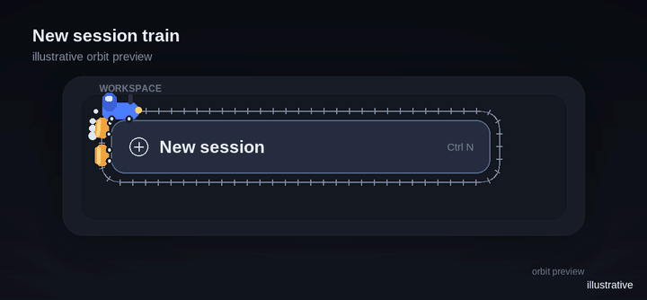

# New session train

A standalone client plugin for DeepSeek Harness: a small locomotive with two
wagons circles the **New session** button in the sidebar.

## Preview



*Illustrative orbit render generated from the plugin's parameters, not a
screenshot of the running app. [Static frame](preview/new-session-train.png).*

| Field | Value |
| --- | --- |
| Package | `@local/dsh-new-session-train` |
| Profile row | `new-session-train` |
| Version | `1.0.0` |
| Type | client bundle, Canvas 2D |
| Dependencies | none |
| Status | installed in the `desktop` profile |

## Features

- Rails with sleepers follow the outline of the New session button.
- A locomotive with a chimney, cab, headlight, and two wagons.
- Smoke rises from the chimney; the train speeds up when the button is hovered.
- The train adapts to the expanded and collapsed sidebar.
- Colors follow the Harness theme.
- The train hides when the button moves off-screen.
- Under `prefers-reduced-motion: reduce` the train stands still without smoke.
- On first mount it removes the old `dsh-control-motion-train` canvas if a train
  remains from an earlier version of the plugin.

The train is drawn on a transparent `<canvas>` above the window. The canvas does
not intercept the mouse, does not modify the button's DOM, and is removed with
the plugin.

## Project layout

| File | Purpose |
| --- | --- |
| `client.js` | Browser half: button lookup, rail geometry, train rendering, smoke, and animation. |
| `index.js` | Host half: an empty `apply()` so the Loader has a row to mount. |
| `package.json` | Manifest with `dsh.bundle.patch` and `dsh.client`. |
| `cordis.patch.yml` | Inserts the `new-session-train` row into the profile composition. |
| `locale/en.json`, `locale/ru.json`, `locale/zh.json` | Title and description for the plugin manager. |
| `icon.svg` | Project icon. |

## How it works

1. The plugin finds the New session button (see below) and reads its
   `getBoundingClientRect()` every frame.
2. A closed rounded outline is built around the button rectangle. The outline is
   sampled into a polyline with cumulative distances, so the train can be placed
   at any distance along the track.
3. The canvas spans the full window width and is `canvasHeight` tall, fixed above
   the interface. It redraws only around the button; the rest stays transparent.
4. The locomotive and wagons are drawn as vectors in local coordinates, rotated
   along the track tangent, and scaled to the button width.
5. Smoke is a particle array: particles are born at the chimney, rise, and fade.
6. The canvas position compensates for scrolling and sidebar height changes;
   dimensions are recalculated on window resize.

The animation uses one `requestAnimationFrame` and paints only a small region.
There are no third-party libraries, fonts, or network requests.

## How the button is found

The plugin first looks for the button with the CSS-module token `newSession`;
the local name is stable even though the hash prefix changes between builds. If
the token is absent, it falls back to the `aria-label` values for New session in
the supported locales.

The brand button, which also starts a session, is intentionally not selected: it
is larger, and the train would circle the logo instead of the menu row. If no
suitable button exists, the canvas stays transparent and draws nothing.

## Installation

The plugin is already installed in the `desktop` profile as the bundle
`@local/dsh-new-session-train`. The profile composition contains the
`new-session-train` row.

To install it again:

```
dsh plugin --profile desktop add C:\path\to\dsh-new-session-train
```

Or use the plugin manager with a local directory installation. Sources live in
`dsh-new-session-train/` in the workspace.

## Configuration

In `client.js`:

```js
const TRAIN = {
  enabled: true,
  baseSpeed: 46,      // px/s without hover
  hoverSpeed: 92,     // px/s on hover
  canvasHeight: 168,  // transparent canvas height
  trackOffset: 7,     // rail offset outside the button edge
  topPadding: 30,     // clearance above the button
};
```

`enabled: false` disables the train completely. The canvas height and paddings
are tuned for the Harness sidebar; change them only for a non-standard layout.
Colors come from the theme (`--dsw-alias-state-business-primary` and neighboring
tokens).

## Troubleshooting

- **No train.** Make sure the sidebar is visible and the New session button is
  present. Then reload the Harness window with `Ctrl+R`: HMR may not have picked
  up the new `client.js`.
- **Two trains.** Reload the window. The new plugin removes the old
  `dsh-control-motion-train` canvas, but if the old `control-motion` version is
  still loaded it needs one HMR cycle or a reload.
- **Train is too small.** Increase `canvasHeight` and the scale coefficient in
  `draw()`; the scale is intentionally reduced for the collapsed sidebar.
- **Train stands still.** Check the system `prefers-reduced-motion` setting:
  reduced motion disables the animation for accessibility.
- **Console error.** The plugin logs `new-session-train: train disabled` and does
  not break the rest of the interface if the canvas or DOM is unavailable.

## Disabling and removal

- Temporarily: turn off the `@local/dsh-new-session-train` bundle in plugin
  settings.
- Permanently: remove the bundle through the plugin manager and delete the
  `dsh-new-session-train` folder.

## Limitations

The plugin has not been verified visually in a browser (this environment has no
page control). Syntax, the manifest, button lookup, and the canvas overlay
lifecycle were checked for the expanded and collapsed sidebar, including the
case where the brand button is larger.

## License

MIT. See [LICENSE](LICENSE). The preview illustrations in `preview/` are
original assets and are covered by the same license; their provenance is
documented in [preview/README.md](preview/README.md).
